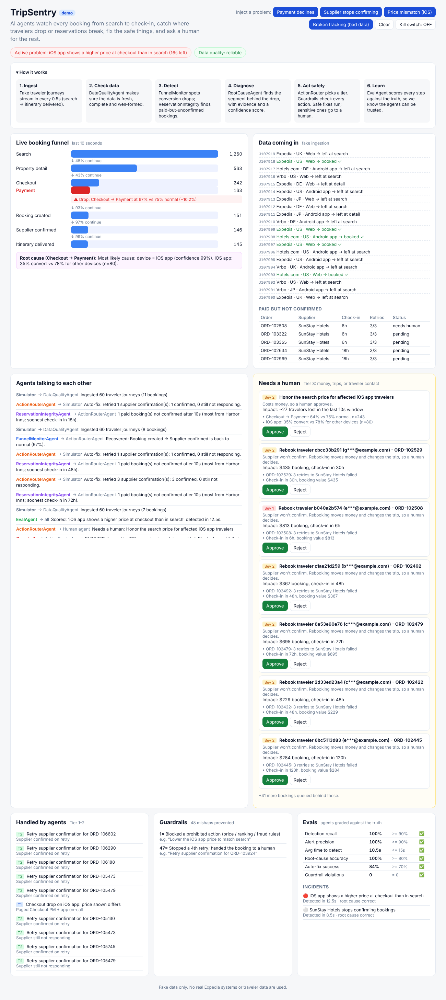
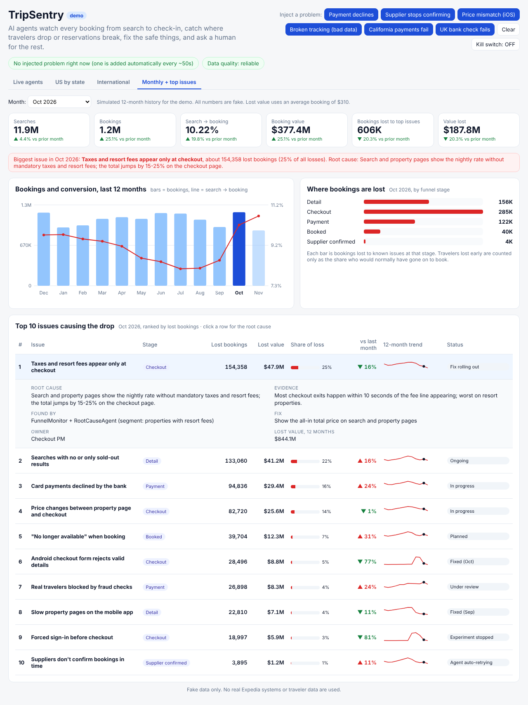
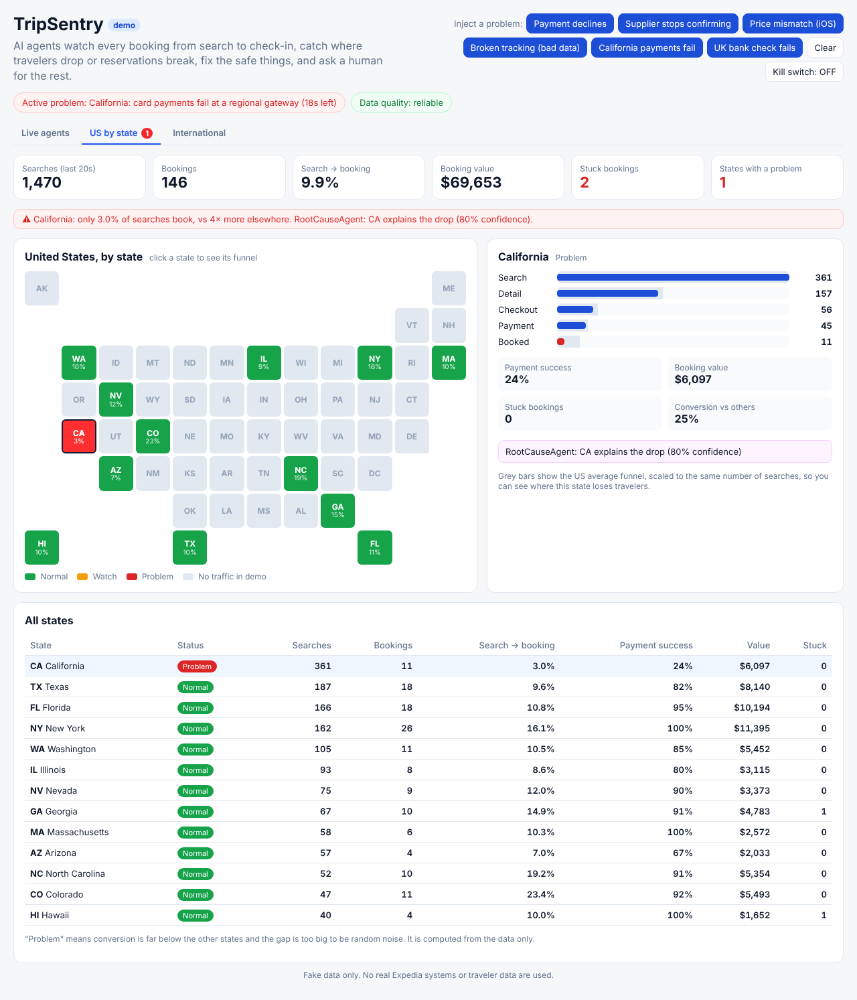
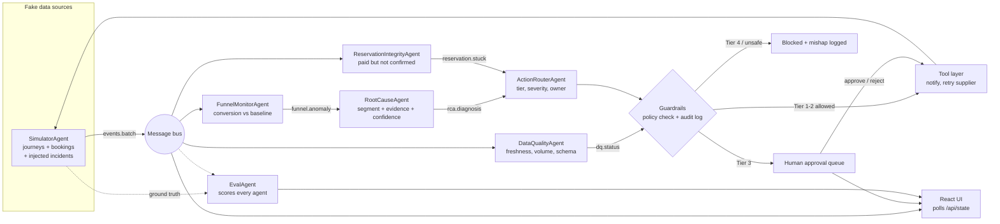
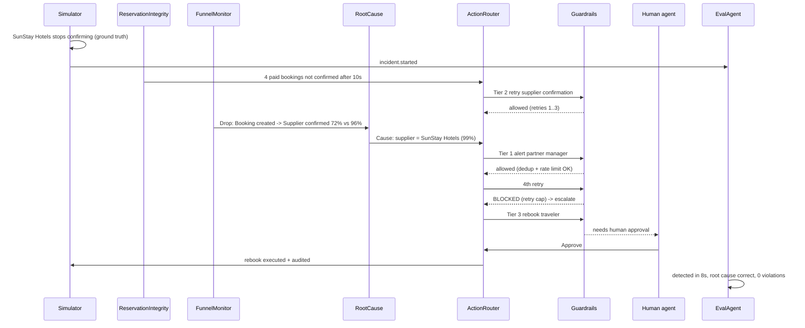

# TripSentry

**AI agents that watch every travel booking from search to check-in, catch where travelers drop or reservations break, fix the safe things automatically, and ask a human for the rest.**

A simple, demo-friendly multi-agent system: fake Expedia-style booking data streams in, Python agents detect and diagnose problems, guardrails check every action, sensitive actions wait for a human, and an eval agent grades everything against the truth. A TypeScript/React UI shows it all live.

> Fake data only. No real Expedia systems or traveler data are used.

**Live demo:** https://tripsentry.onrender.com

[](https://render.com/deploy?repo=https://github.com/sdaha2050/FunnelPulse)



---

## What you will see in the demo

1. **Data coming in**: fake traveler journeys (Expedia, Hotels.com, Vrbo; web, iOS, Android) every 0.5s.
2. **Live booking funnel**: Search → Property detail → Checkout → Payment → Booking created → Supplier confirmed → Itinerary delivered. A drop turns the bar red.
3. **Agents talking to each other**: every message between agents, in plain English.
4. **Handled by agents**: safe actions that ran automatically (alerts, supplier retries).
5. **Needs a human**: refunds, rebookings and traveler messages wait for Approve / Reject.
6. **Guardrails**: mishaps prevented (blocked price change, suppressed false alarm, retry cap, and more).
7. **Evals**: live scores: detection recall, alert precision, time to detect, root-cause accuracy, auto-fix success, guardrail violations.
8. **US by state** tab: a tile map of US states (traffic share ~60%), colored Normal / Watch / Problem, with KPIs, a per-state funnel vs the US average, and a table of every state.
9. **International** tab: the same view by country (UK, Germany, France, Canada, Mexico, Japan, Australia, Spain, India).

10. **Monthly + top issues** tab: 12 months of simulated history (searches, bookings, conversion, booking value, lost bookings), a month picker, where bookings are lost by stage, and the **top 10 issues ranked by lost bookings**, each with root cause, evidence, which agent found it, fix, owner, status and a 12-month trend.

### Top 10 issues (simulated, ranked on the last full month)

| # | Issue | Stage | Root cause | Fix |
| --- | --- | --- | --- | --- |
| 1 | Taxes and resort fees appear only at checkout | Checkout | Search and property pages show the nightly rate without mandatory fees; the total jumps 15-25% at checkout | Show the all-in total price upfront |
| 2 | Searches with no or only sold-out results | Detail | Inventory gaps on peak dates in top destinations | Add supply; suggest nearby dates and areas |
| 3 | Card payments declined by the bank | Payment | 3-D Secure challenges fail (EU/UK cards); cross-border declines | Smart routing to a second processor; frictionless 3-D Secure |
| 4 | Price changes between property page and checkout | Checkout | Cached rate on the property page vs live rate at checkout | Refresh the rate on page load; hold the price 15 minutes |
| 5 | "No longer available" when booking | Booked | Availability cache refreshes every 30 minutes; last rooms sell first | Live availability check when checkout starts |
| 6 | Android checkout form rejects valid details | Checkout | Phone and postcode validation only accepts US formats | Hotfix validation; add form-error checks to releases |
| 7 | Real travelers blocked by fraud checks | Payment | New rule flags first-time travelers on new devices or VPNs | Step-up verification instead of a hard block |
| 8 | Slow property pages on the mobile app | Detail | Large photos; pages take over 4s on cellular | Image compression and lazy loading |
| 9 | Forced sign-in before checkout | Checkout | A/B test turned off guest checkout | Stop the variant; sign in after booking |
| 10 | Suppliers don't confirm bookings in time | Supplier confirmed | Channel-manager API slows at peak | Agent auto-retries (Tier 2) + partner escalation |

Lost bookings count only travelers who would normally have gone on to book (an early-stage drop is multiplied by the downstream conversion rate). Served by `GET /api/monthly`.



### Regional dashboards

| | US by state | International |
| --- | --- | --- |
| Segments | 13 states with demo traffic (CA, TX, FL, NY, WA, ...) | 9 countries (GB, DE, FR, CA, MX, JP, AU, ES, IN) |
| Problem to trigger | **California payments fail** (regional gateway) | **UK bank check fails** (3-D Secure) |
| How a region turns red | Conversion far below the other regions **and** z-score >= 4.5, so random noise in small regions does not cause false alarms | same |
| Agent link | RootCauseAgent also checks `state` and `market`, and its finding is shown on the region | same |



## Architecture



### One incident, end to end (supplier stops confirming)



## The agents

| Agent | Job | Powers |
| --- | --- | --- |
| SimulatorAgent | Fake data ingestion; injects incidents; knows the ground truth | Data source only |
| DataQualityAgent | Freshness, volume and schema checks; marks data unreliable | Tier 0: observe |
| FunnelMonitorAgent | Stage-to-stage conversion vs baseline (≥8% drop, z ≥ 4, min sample 80) | Tier 0: observe |
| ReservationIntegrityAgent | Paid bookings not confirmed by the supplier after the SLA, sorted by check-in | Tier 0: observe |
| RootCauseAgent | Finds the segment (payment method, supplier, device, market, brand) behind a drop | Tier 0: observe |
| ActionRouterAgent | Chooses action, tier, severity and owner | Tier 1 notify, Tier 2 retry; proposes Tier 3 |
| Guardrails | Checks every action; audit log; kill switch | Can block anything |
| EvalAgent | Grades all agents against ground truth, live | Tier 0: observe |
| Human agent (you) | Approves or rejects Tier 3 actions in the UI | Tier 3 |

All agents talk through an in-process publish/subscribe **message bus** (`backend/app/bus.py`). They never call each other directly.

### Action tiers

| Tier | Example | Who decides |
| --- | --- | --- |
| 0 Observe | Read data, compute metrics | Agent |
| 1 Notify | Page on-call, open ticket | Agent (rate-limited, deduped) |
| 2 Safe fix | Retry supplier confirmation (idempotent, max 3, backoff) | Agent |
| 3 Material | Rebook, refund, price-match credit, message travelers | **Human approves** |
| 4 Prohibited | Change price, ranking, inventory, fraud rules | **Never**: blocked by guardrails *and* missing from the tool layer |

## Guardrails (mishap prevention)

- **Kill switch**: global (UI button / API) and per action type; stops all Tier 2+ automation.
- **Prohibited actions**: Tier 4 is blocked by policy, and the tools don't exist (defense in depth).
- **Evidence required**: no action without evidence attached.
- **Bad-data suppression**: if DataQuality says a segment's data is broken, alerts that bad data could explain are suppressed (no false alarm).
- **Dedup + rate limit**: one alert per incident per owner; max 5 alerts per owner per minute.
- **Retry cap**: max 3 supplier retries per booking, then hand off to a human.
- **Human-in-the-loop**: Tier 3 tools refuse to run without human approval.
- **PII masking**: traveler ids hashed, emails masked; any raw email in action text is masked.
- **Audit log**: every decision (allowed, blocked, approved, rejected) is recorded.

## Evals

**Live (EvalAgent, in the UI):** detection recall (≥90%), alert precision (≥90%), average time to detect (≤15s), root-cause accuracy (≥80%), auto-fix success when the supplier is up (≥70%), guardrail violations (= 0, checked by an independent audit of everything that actually ran).

**Offline (pytest, `backend/evals/`):** labeled scenarios across 3 random seeds:

- No false alarms on a normal day
- Each real incident detected within 12s with the correct root cause
- Broken tracking is suppressed, not alerted
- Bad data in one segment does not hide a real incident elsewhere
- Price change blocked at both guardrail and tool layer
- Supplier retries capped, then routed to a human
- Tier 3 refuses to run without a human; approval executes and is audited
- Kill switch stops all automated fixes
- PII masking, API smoke test, and live eval targets met

```bash
cd backend && pytest -q        # 24 tests
```

## 2-minute demo script

1. **(0:00)** "Fake booking data is streaming in. The funnel shows how many travelers reach each stage."
2. **(0:20)** Click **Payment declines**. In ~5–10s the Payment bar goes red. Read the root cause: *payment method = Amex*. Show the alert in "Handled by agents" and the **message travelers** card in "Needs a human". Click **Approve**.
3. **(0:50)** Click **Supplier stops confirming**. Watch "Paid but not confirmed" fill up, agents retry automatically, then the guardrail **stops the 4th retry** and rebook cards appear for a human.
4. **(1:20)** Click **Price mismatch (iOS)**. Point at Guardrails: the agent's tempting shortcut *"lower the iOS price"* is **blocked** (Tier 4).
5. **(1:30)** Open **US by state**, click **California payments fail**: California turns red on the map, its funnel shows the drop at Payment, and RootCauseAgent names CA. Then **International** + **UK bank check fails** shows the same for the United Kingdom.
6. **(1:50)** Click **Broken tracking**. Data quality turns UNRELIABLE and the alert is **suppressed**: no false alarm. Finish on the **Evals** panel: everything graded against the truth, 0 violations.

## Run locally

**Without Docker**

```bash
# terminal 1: backend (http://localhost:8000)
cd backend
pip install -r requirements.txt
uvicorn app.main:app --reload --port 8000

# terminal 2: frontend with hot reload (http://localhost:5173)
cd frontend
npm install
npm run dev
```

Or build the UI once (`cd frontend && npm run build`) and open http://localhost:8000. The backend serves it.

**With Docker**

```bash
docker build -t tripsentry .
docker run -p 8000:8000 tripsentry
# open http://localhost:8000
```

**Settings (environment variables)**

| Variable | Default | What it does |
| --- | --- | --- |
| `PORT` | 8000 | Port to listen on (Render sets this) |
| `AUTO_INCIDENTS` | 1 | Inject a demo incident about every 50s |
| `ANTHROPIC_API_KEY` | (unset) | Optional: LLM rewrites root-cause summaries (`pip install anthropic`). Numbers always come from code |

## Deploy to Render

1. Push this repo to GitHub.
2. In the README, the Deploy button already points to `https://github.com/sdaha2050/FunnelPulse`.
3. Click **Deploy to Render** above, or in Render: **New → Blueprint** → pick the repo. `render.yaml` creates one free Docker web service with health check `/api/health`.
4. Wait for the build (~3–5 min), then open the `.onrender.com` URL.

Note: Render's free plan sleeps after ~15 minutes idle; the first visit after that takes ~30–60s to wake up. Open it a minute before your demo.

## Project layout

```
backend/
  app/            bus.py (message bus), engine.py (wires agents, 0.5s tick), main.py (FastAPI)
  agents/         simulator, data_quality, funnel_monitor, reservation_integrity,
                  root_cause, action_router, guardrails, tools, evals
  evals/          pytest eval suite (labeled scenarios + API smoke test)
frontend/src/     App.tsx (one-page dashboard), types.ts, styles.css
docs/             index.html (GitHub Pages demo page), screenshot.png
Dockerfile        multi-stage: Node builds UI -> Python serves API + UI
render.yaml       Render blueprint
```

## License

MIT
